# tackle

The estate's live game-editor broker: a Rust MCP server that brokers
live game-editor sessions — one engine-agnostic core, per-engine
backends inside the editors (a C# package for Unity first, a GDScript
add-on for Godot later). Named for the block and tackle: the
rope-and-pulley system that lets a small crew move heavy loads.

Design posture: authenticated hops with no unauthenticated mode,
explicit session routing, main-thread serialization, idempotent
mutations, mandatory undo participation, and flowguard labels on the
execute class. Lumen consumes tackle, never hosts it; fathom keeps
the offline slice.

## Progress

<!-- tracker:start -->

**21% — 5 of 24 gates closed — updated 2026-10-21.**
Full record: [CHECKLIST.md](CHECKLIST.md) — every item traces to a stage gate in the program documents; the bar moves only on gated evidence.
<!-- tracker:end -->

Progress here is tracked from ideation to the finished 1.0 and
beyond: each checklist item is a stage gate from the program
documents (study → U0 spike → read core → write core → execute
class → Godot), and it closes only on verified evidence.

## License

Apache-2.0 — see [LICENSE](LICENSE).
